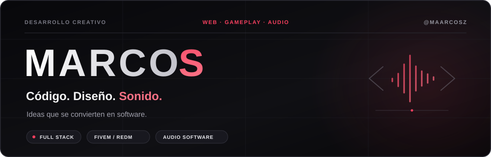

  

 

Creo webs, herramientas y experiencias de juego. También desarrollo software para música.

### En qué trabajo

- **Web y producto** · React, Next.js, TypeScript y WordPress.
- **Sistemas de juego** · FiveM, RedM, Lua e interfaces NUI.
- **Herramientas de escritorio** · Electron y Node.js.
- **Software de audio** · C++ y JUCE.

Me gusta unir funcionalidad, diseño y una buena experiencia de uso.
